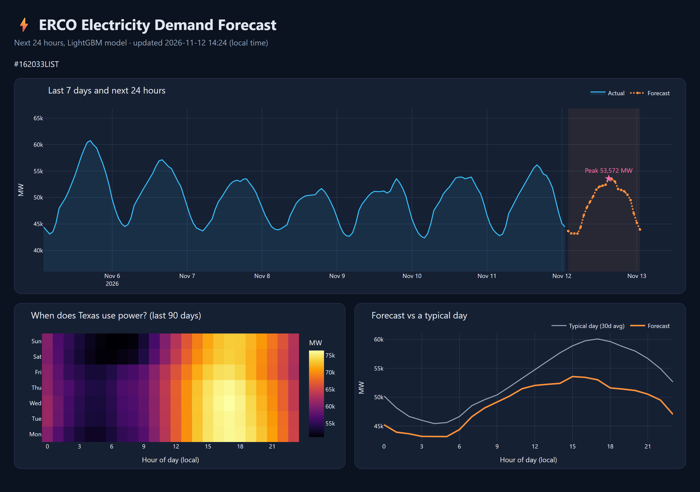

# ⚡ Energy Demand Forecaster

Daily 24-hour electricity demand forecast for Texas (ERCOT) using EIA grid data, weather, LightGBM and Plotly. About 21% more accurate than a "same hour yesterday" baseline (2.9% MAPE).

## Run
    pip install pandas numpy lightgbm plotly requests scikit-learn joblib playwright
    set EIA_API_KEY=your_key
    python train.py
    python daily.py
    python dashboard.py